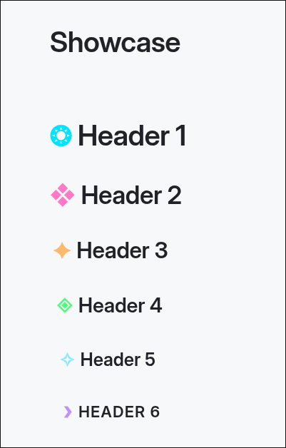
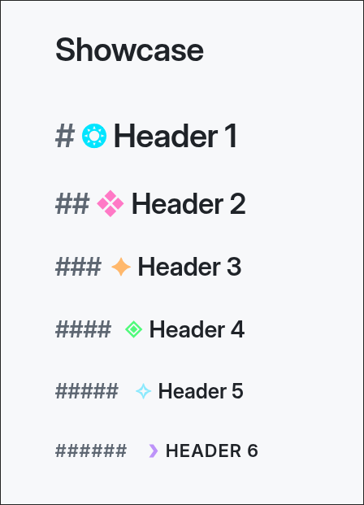

# Obsidian Header Icons - OHI

Obsidian Header Icons is a small CSS snippet that allows you to add an icon to the left of headers

The snippet is fully customizable! You can change icons, colors, and offsets if you want to! 

Example:

And an example with Markdown text:

## How to install?

Copy the `ohi.css` file to your vault's `{vault}/.obsidian/snippets` directory

Then, go to Settings -> Appearance -> CSS snippets, and then enable the `ohi.css` snippet!
